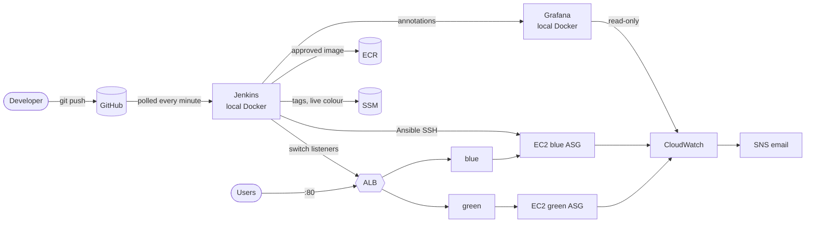

# DevSecOps Shield

**A secure, self-healing CI/CD pipeline on AWS with Blue-Green deployment**, built around
**SplitEase**, a small Flask bill-splitting web app.

A `git push` to `main` runs unit tests, a secret scan (Gitleaks) and a container vulnerability scan
(Trivy). Only an image that passes every gate is pushed to Amazon ECR and deployed, by Ansible, to
the **idle** colour (blue or green) behind an Application Load Balancer. Once the new version is
verified healthy and running the new build, the ALB switches production traffic to it in one step.
The old colour keeps running, so a rollback takes seconds. Docker restart policies, ALB health
checks and Auto Scaling Groups repair failures automatically. CloudWatch collects logs and metrics
and sends alarm emails, and a local Grafana dashboard shows everything on one screen, with a marker
for every release and rollback.

```
Build -> Test -> Secure -> Containerize -> Scan -> Store -> Deploy -> Verify -> Switch Traffic -> Self-Heal -> Monitor
```

| Document | What is in it |
|---|---|
| [docs/architecture/architecture.md](docs/architecture/architecture.md) | Diagrams, every AWS resource, every configured value, IAM matrix, dashboard map |
| [docs/report/report.md](docs/report/report.md) | Project report: design, all measured results, problems and fixes, cost, glossary, viva questions |
| [docs/notes/](docs/notes/README.md) | One plain-English study note per file (52 notes) |
| [docs/screenshots/CHECKLIST.md](docs/screenshots/CHECKLIST.md) | What to screenshot or record for every demo |
| [security/trivy-policy.md](security/trivy-policy.md) | Vulnerability policy of Security Gate 2 |
| [PROGRESS.md](PROGRESS.md) | Build log: status, decisions, incidents, next steps |
| [CLAUDE.md](CLAUDE.md) | The project specification |

---

## Contents
1. [Architecture at a glance](#1-architecture-at-a-glance)
2. [Technology stack and versions](#2-technology-stack-and-versions)
3. [The application: SplitEase](#3-the-application-splitease)
4. [Repository layout](#4-repository-layout)
5. [The pipeline](#5-the-pipeline)
6. [Blue-Green deployment and rollback](#6-blue-green-deployment-and-rollback)
7. [AWS infrastructure (Terraform)](#7-aws-infrastructure-terraform)
8. [Deployment with Ansible and user data](#8-deployment-with-ansible-and-user-data)
9. [Security](#9-security)
10. [Self-healing](#10-self-healing)
11. [Monitoring: CloudWatch, alarms, Grafana](#11-monitoring-cloudwatch-alarms-grafana)
12. [Setup from zero](#12-setup-from-zero)
13. [Every working session (start / stop routine)](#13-every-working-session-start--stop-routine)
14. [Running the demos](#14-running-the-demos)
15. [Day-to-day operations](#15-day-to-day-operations)
16. [Cost](#16-cost)
17. [Troubleshooting](#17-troubleshooting)
18. [Lessons learned](#18-lessons-learned)
19. [Future work](#19-future-work)

---

## 1. Architecture at a glance



Full diagrams (system, pipeline, Blue-Green sequence, self-healing, security boundaries):
[docs/architecture/architecture.md](docs/architecture/architecture.md).

| Where | What runs there |
|---|---|
| **Laptop** (Windows + WSL2 Ubuntu, Docker Desktop) | Jenkins and Grafana in Docker (compose stack), Terraform, git |
| **GitHub** | Repository `NetraGupta24/devsecops-shield` (`main`, `feature/v2`, 4 demo branches) |
| **AWS ap-south-1 (Mumbai)** | 47 resources: VPC, ALB, 2 Auto Scaling Groups of t3.micro, ECR, SSM, IAM, CloudWatch, SNS |

**Why Jenkins and Grafana run on the laptop:** a free-plan t3.micro has 1 GB of RAM, which isn't
enough for Jenkins + Docker builds + Trivy, and running them locally costs nothing. Because GitHub
can't reach `localhost`, Jenkins **polls** GitHub instead of receiving webhooks.

## 2. Technology stack and versions

| Area | Tool | Version | Role in this project |
|---|---|---|---|
| App | Python / Flask / Gunicorn | 3.14 / 3.1.3 / 27.0.0 | SplitEase web app and production server |
| Tests | pytest | 9.2.0 | 144 unit tests |
| Container | Docker (Desktop 29.8, CLI 29.9.3 in Jenkins), base `python:3.14.10-slim-trixie` | | Image `splitease:build-<N>` |
| CI/CD | Jenkins LTS | 2.580.2 (JDK 21) | Multibranch pipeline + rollback job, 1 executor |
| Secret scan | Gitleaks | 8.30.1 | Security Gate 1 |
| Image scan | Trivy | 0.76.1 | Security Gate 2 |
| Registry | Amazon ECR | | Approved images only, immutable tags |
| IaC | Terraform / AWS provider | 1.16.3 / 6.72.0 | All AWS resources |
| Deployment | Ansible core / `amazon.aws` / boto3 | 2.21.6 / 11.5.1 / 1.43.127 (in Jenkins) | Deploy to running instances, dynamic inventory |
| Cloud CLI | AWS CLI v2 | 2.39.7 (Jenkins), 2.31 (laptop) | ECR login, SSM, ALB listener switching |
| Compute | EC2 t3.micro, Amazon Linux 2023 | | 1–2 instances per colour |
| State | SSM Parameter Store (standard) | | Live colour, image tag per colour, chaos flag |
| Monitoring | CloudWatch + SNS; Grafana | Grafana 13.2.5 | Logs, metrics, alarms, email; dashboard |
| Local OS | Windows + WSL2 Ubuntu 26.04 | | Ansible needs Linux |

All tool versions are **pinned**. The Jenkins image downloads each tool and checks its SHA-256
checksum before installing it.

## 3. The application: SplitEase

A **stateless** Flask bill splitter. It has no database, because Auto Scaling and Blue-Green replace
servers all the time and any data stored on a server would be lost.

| Endpoint | Method | What it does |
|---|---|---|
| `/` | GET | Web page: total + people → each person's share. v2 adds "By percentage / By amount" and shows `SplitEase v2.0.0 · build N` in the footer |
| `/api/split` | POST | JSON API, e.g. `{"total": "100", "people": ["Asha","Ben","Chitra"]}` → 33.34 / 33.33 / 33.33. v2: `"mode": "percentage"` or `"amount"` with `[{"name": ..., "value": ...}]` |
| `/health` | GET | `{"status": "ok"}` (200). Used by the ALB health check |
| `/version` | GET | `{"app": "splitease", "version": "2.0.0", "build": "15"}`. Used by the pipeline to prove the new build is running |
| `/crash` | GET | **Only if `CHAOS_MODE=true`** (else 404). Signals the Gunicorn master so the whole container stops and Docker restarts it |
| `/cpu?seconds=N` | GET | **Only if `CHAOS_MODE=true`** (else 404). Burns every CPU core for N seconds (max 300) in background processes and returns 202 immediately |

- **Money in paise (integers), never floats.** Equal split: `divmod(total, n)`, and the leftover paise
  go one each to the first people. Percentage split: integer basis points and the **largest remainder
  method**. Amount split: the amounts must add up to the total exactly. The shares **always add up to
  the exact total** (tested for many totals and group sizes).
- **Validation:** amounts > 0, at most 2 decimals, at most Rs 10 crore; 1–50 people; names not
  empty, not duplicated (case-insensitive), at most 40 characters; request body at most 16 KB.
- **Security headers:** `Content-Security-Policy` (no inline scripts), `X-Frame-Options: DENY`,
  `X-Content-Type-Options: nosniff`, `Referrer-Policy: no-referrer`. Names are shown with
  `textContent` (no HTML injection).
- **Environment variables:** `CHAOS_MODE` (`false` by default), `BUILD_NUMBER` (baked into the
  image by Jenkins).
- **Container:** Gunicorn, 2 workers, port 5000, user `app` (uid 10001), logs to stdout/stderr.
- **Versions:** v1.0.0 (equal split) on `main` originally; **v2.0.0** (custom splits + version
  footer) is on `main` now; v2.1.0 exists only on `demo/bad-release`.
- **Tests (144):** 120 in `test_splitter.py` (rounding, add-up property, invalid input, percentage
  and amount maths) and 24 in `test_app.py` (every endpoint, API errors, security headers, footer,
  chaos endpoints 404 when off, and chaos behaviour tested with mocks so nothing is really killed).

## 4. Repository layout

```
CLAUDE.md                      project specification
README.md                      this file
PROGRESS.md                    build log (status, decisions, incidents)
app/
  app.py                       Flask routes, security headers, chaos endpoints
  splitter.py                  money maths (paise, equal / percentage / amount)
  templates/index.html         web page;  static/app.js, static/style.css
  requirements.txt             Flask, Gunicorn (pinned);  requirements-dev.txt adds pytest
  pytest.ini, tests/           conftest.py, test_splitter.py, test_app.py
Dockerfile, .dockerignore      production image; build context = allow-list (app/ only)
Jenkinsfile                    CI on every branch + Blue-Green release on main
Jenkinsfile.rollback           rollback job
jenkins/
  Dockerfile                   Jenkins + Docker CLI, Python, Gitleaks, Trivy, AWS CLI, Ansible (pinned, sha256)
  docker-compose.yml           Jenkins (127.0.0.1:8080) + Grafana (127.0.0.1:3000)
  .env.example                 template for the gitignored .env (Grafana secrets)
  plugins.txt                  Jenkins plugins baked into the image
  init.groovy.d/executors.groovy   1 executor
  jobs/splitease, jobs/splitease-rollback   job definitions as code (config.xml)
grafana/
  provisioning/datasources/cloudwatch.yml   CloudWatch data source (keys from env)
  provisioning/dashboards/splitease.yml     dashboard provider
  dashboards/splitease-production.json      "SplitEase - Production" dashboard
scripts/
  bluegreen.sh                 live-color, get/set-tag, wait-healthy, check-version, switch, status
  grafana-annotate.sh          posts a Grafana annotation; always exits 0
terraform/                     provider, variables, outputs, network, security_groups, ecr, iam, alb,
                               launch_templates, autoscaling, ssm, cloudwatch, user_data.sh.tftpl,
                               terraform-runner-policy.json, terraform.tfvars.example, .terraform.lock.hcl
ansible/                       ansible.cfg, inventory/aws_ec2.yml, playbooks/configure.yml,
                               playbooks/deploy.yml, roles/docker/tasks/main.yml
security/trivy-policy.md       Trivy gate policy and evidence
docs/                          architecture/, report/, notes/ (52), screenshots/CHECKLIST.md
```

## 5. The pipeline

Jenkins job **`splitease`** is a *Multibranch Pipeline*. It checks GitHub every minute (branch
indexing, the only trigger) and builds every branch that has a new commit. **Every branch** gets
the CI stages. **Only `main`** continues to the release stages. Builds run one at a time (1
executor).

| # | Stage | Branches | What happens | If it fails |
|---|---|---|---|---|
| 1 | Checkout | all | Clone with full history | stop |
| 2 | Unit tests | all | Fresh virtualenv, `pytest`, JUnit report in Jenkins | stop: nothing built |
| 3 | Gitleaks | all | `gitleaks git --redact --log-opts=HEAD`: every commit on this branch | stop: nothing built |
| 4 | Docker build | all | `docker build --pull --build-arg BUILD_NUMBER=N -t splitease:build-N .` | stop |
| 5 | Trivy | all | `--severity HIGH,CRITICAL --ignore-unfixed --exit-code 1` | stop: image never reaches ECR |
| 6 | Push to ECR | main | Log in with the Jenkins IAM user, push `build-N`, log out | stop |
| 7 | Find idle colour | main | Idle = opposite of `/splitease/live_color` | stop |
| 8 | Deploy to idle colour | main | SSM `/splitease/<idle>/image_tag = build-N`; SSH key pre-flight check; `ansible-playbook deploy.yml` (exit 4 = unreachable is tolerated) | stop; idle tag restored |
| 9 | Health check | main | All idle targets **healthy 5 checks in a row** (fails fast on HTTP errors), then `:8080/version` returns N **5 times in a row** | stop; idle tag restored; **port 80 untouched** |
| 10 | Switch traffic | main | `:80 → idle`, `:8080 → old`, SSM `live_color`, **Grafana annotation** (can't fail), `:80/version` check. First release only: gives the never-used colour the same build | |
| 11 | Post | all | Print result + status; delete local images | |

**Credentials (Jenkins Credentials store only):**

| ID | Kind | Used for |
|---|---|---|
| `aws-access-key-id`, `aws-secret-access-key` | Secret text | Jenkins IAM user `splitease-jenkins` (ECR, SSM, ALB) |
| `ec2-ssh-key` | SSH Username with private key (`ec2-user`) | Ansible over SSH |
| `grafana-api-token` | Secret text | Grafana service-account token for annotations |

**Rollback job `splitease-rollback`** (manual "Build Now"): shows the current state → refuses if
the other colour never had a release → checks the other colour is healthy (2 checks) → switches
the listeners back → Grafana annotation → checks `:80/version` returns the previous build.

Jenkins plugins baked into the image: workflow-aggregator, workflow-multibranch, git,
credentials-binding, ssh-credentials, pipeline-stage-view, timestamper, junit, ws-cleanup (plus
the setup wizard's suggested plugins, 95 in total).

## 6. Blue-Green deployment and rollback

| SSM parameter | Meaning | Initial value | Changed by |
|---|---|---|---|
| `/splitease/live_color` | Colour on port 80 | `green` (so the first release goes to blue) | release, rollback |
| `/splitease/blue/image_tag` | Image blue runs | `none` | release to blue |
| `/splitease/green/image_tag` | Image green runs | `none` | release to green |
| `/splitease/chaos_mode` | Enables `/crash` and `/cpu` on the next deployment | `false` | you (demos) |

- **Port 80** = production (everyone). **Port 8080** = test listener, always pointing at the
  *idle* colour, open **only to your IP**. A new version is checked through the real load balancer
  before anyone uses it.
- **Switch** = two `ModifyListener` calls + one SSM update. It's instant, and the servers are not
  touched.
- **Rollback** = the same switch in reverse. The previous version never stopped running, so nothing
  is rebuilt.
- **First release:** the old colour has never run anything (`none`). After the first switch it gets
  the same build, so the ASG replaces its empty instance and it becomes a valid rollback target.
- **Health gate details:** ALB health check `GET /health` every 15 s (healthy after 2 passes,
  unhealthy after 3 failures). Right after Ansible replaces a container, the ALB still shows the
  **old** container's status for up to 45 s, so the pipeline requires **5 consecutive healthy
  polls (60 s)**. If the ALB reports `Target.ResponseCodeMismatch` (the app answers with an error)
  for ~1 minute, the release is declared bad immediately.

## 7. AWS infrastructure (Terraform)

**47 resources**, all tagged `Project=splitease`, created by `terraform apply` from the laptop as
your own IAM user. The full inventory and every value are in
[architecture.md §8–§10](docs/architecture/architecture.md) (inventory, every configured value, IAM matrix).

| Area | What |
|---|---|
| Network | VPC `10.20.0.0/16`; public subnets `10.20.0.0/24` (ap-south-1a) and `10.20.1.0/24` (ap-south-1b); Internet Gateway; route table. **No NAT, no private subnets** (cost) |
| Security groups | ALB: 80 from anywhere, 8080 from `my_ip`, egress 5000 to app SG. App: 5000 from ALB SG, 22 from `my_ip`, egress 443 only |
| ECR | `splitease`, immutable tags, AES256, keep last 5 images, `force_delete` |
| ALB | `splitease-alb`, listeners 80 + 8080 (`ignore_changes = [default_action]`), target groups `splitease-blue/green` (port 5000, `/health`, deregistration delay 30 s), drops invalid headers |
| Launch templates | AL2023 (latest), t3.micro, **standard CPU credits**, detailed monitoring, IMDSv2 (hop limit 1), encrypted gp3, key pair `splitease-deploy`, instance profile, user data |
| Auto Scaling | `splitease-blue/green`: min 1 / desired 1 / max 2, ELB health check, **grace 600 s** (measured), target tracking 50% CPU, `ignore_changes = [desired_capacity]` |
| SSM | the 4 parameters above (`ignore_changes = [value]`) |
| IAM | EC2 role, Jenkins user, Grafana user (read-only); **no access keys created by Terraform** |
| CloudWatch | log group `/splitease/app` (7 days), 4 alarms → SNS topic `splitease-alerts` → email |

**Variables** (`terraform.tfvars`, gitignored; template `terraform.tfvars.example`):

| Variable | Default | Meaning |
|---|---|---|
| `my_ip` | *(required)* | Your public IP as `x.x.x.x/32` (SSH + port 8080) |
| `alert_email` | *(required)* | Alarm email address |
| `aws_region` | `ap-south-1` | Region |
| `project` | `splitease` | Name prefix and tag |
| `instance_type` | `t3.micro` | Only `t3.micro`/`t3.small` allowed |
| `ssh_public_key_path` | `~/.ssh/splitease-deploy.pub` | Ansible's SSH key |
| `vpc_cidr` | `10.20.0.0/16` | VPC range |
| `app_port` | `5000` | Container port |
| `health_check_grace_period` | `600` | Seconds a new instance gets to boot |

**Outputs:** `app_url`, `test_url`, `alb_dns_name`, `ecr_repository_url`, `jenkins_iam_user`,
`grafana_iam_user`, `autoscaling_groups`, `sns_topic_arn`, `initial_live_color`.

**Your Terraform user** needs `terraform/terraform-runner-policy.json` (EC2/ELB/Auto Scaling in
ap-south-1 only; IAM, ECR, SSM, Logs, alarms and SNS only on `splitease-*`; service-linked roles for
ELB and Auto Scaling). It was validated with IAM Access Analyzer and a policy simulation.

## 8. Deployment with Ansible and user data

| Mechanism | When | What it does |
|---|---|---|
| **Ansible** `deploy.yml` (Jenkins stage 8) | A release | For every *running* instance of the idle colour (dynamic inventory, groups `env_blue` / `env_green`): wait for cloud-init → make sure Docker runs (role `docker`) → ECR login (token never printed) → pull → replace the container only if image or chaos flag changed → wait for `/version`, check build number → prune old images |
| **EC2 user data** | A *new* instance boots (scale-out, replacement) | Install Docker → read the colour's image tag and chaos flag from SSM → ECR login → run the container with `--restart unless-stopped` and the `awslogs` driver (stream `<colour>/<instance-id>`) |

Both read the **same SSM parameters**, so a server created by Auto Scaling at 3 a.m. runs the same
version Ansible deployed. Run Ansible by hand (inside the Jenkins container, which has boto3):
`ansible-playbook playbooks/deploy.yml -e target_color=green -e ecr_repository_url=<repo> --private-key <key>`.

## 9. Security

**Pipeline gates:** unit tests → Gitleaks (whole branch history) → Trivy (fixable HIGH/CRITICAL).
Only `main` releases, and only images that passed every gate exist in ECR (immutable `build-<N>`
tags).

**Identities (least privilege):**

| Identity | Can do | Cannot do |
|---|---|---|
| EC2 instance role | Pull from repo `splitease`; read `/splitease/*`; write to `/splitease/app` logs | Anything else |
| `splitease-jenkins` (user) | Push to `splitease`; get/put `/splitease/*`; describe ELB/EC2/ASG; **ModifyListener on our 2 listeners only** | Create/delete infrastructure, IAM |
| `splitease-grafana` (user) | **Read** CloudWatch metrics/alarms; query `/splitease/app` logs; describe EC2/tags | Any write |
| Your Terraform user | `SplitEaseTerraformRunner` + `ReadOnlyAccess` | Other regions; IAM outside `splitease-*`; its own permissions |

**Secrets handling:** no access key is in git, Terraform state or files in the repo. Keys are
created by hand and stored only in Jenkins Credentials or the gitignored `jenkins/.env` (mode 600).
`.gitignore` blocks `*.tfstate`, `terraform.tfvars`, `.env`, `*.pem`, keys. The only secret ever
committed is the **fake** demo key on `demo/fake-secret`. (One local incident is logged in
`PROGRESS.md`: the Grafana admin password appeared in a local session transcript.)

**Network:** app port only from the ALB; SSH and port 8080 only from your IP; HTTPS-only egress;
IMDSv2 with hop limit 1 (containers can't steal instance credentials); encrypted EBS; ALB drops
invalid headers. Jenkins and Grafana listen on `127.0.0.1` only.

**Container:** slim base, `apt-get upgrade`, pip removed, non-root user (uid 10001), read-only
code owned by root, chaos endpoints off by default (tested).

**Supply chain:** pinned versions everywhere (Python packages, base image, Jenkins tools with
SHA-256 checks, Terraform provider lock file, Ansible collection, Grafana image). Trivy is pinned
deliberately because its own release channel was attacked in 2026.

## 10. Self-healing

All rows were measured on AWS (2026-11-10/11). Demo 10 uses the same replacement mechanism as row 2.

| Failure | Detection | Automatic recovery | Measured |
|---|---|---|---|
| App crash (`/crash`) | Container exits | Docker `--restart unless-stopped` | One 502 for ~2 s; restart count 0 → 1 |
| Container stopped (`docker stop`) | ALB `/health` fails (3 × 15 s) | ASG replaces the instance; user data boots the right version | Unhealthy after 47 s; replaced 1 min 47 s after the stop |
| CPU spike (`/cpu`) | ASG average CPU > 50% (1-min metrics) | Target tracking adds an instance, removes it later | Scale-out ~4 min after the load started (both runs); scale-in ~16 min after it ended |
| Instance terminated | ASG below desired | ASG launches a replacement | New t3.micro healthy in ~5–8 min |
| Bad release | Idle health gate (`ResponseCodeMismatch`) | No switch; idle SSM tag restored; ASG replaces the broken idle instance | Stopped in ~90 s; live untouched |
| Problem after release | You / alarm email | `splitease-rollback` job | 154 s job; no rebuild |

## 11. Monitoring: CloudWatch, alarms, Grafana

| Signal | Where |
|---|---|
| Container logs | CloudWatch Logs `/splitease/app` (7 days), stream `<colour>/<instance-id>` |
| Metrics | EC2 CPU per ASG (1 minute), ASG group metrics, ALB/target-group metrics, CPU credit balance |
| Alarms → SNS email | `splitease-<colour>-high-cpu`: average > 70% for 3 min · `splitease-<colour>-unhealthy-hosts`: UnHealthyHostCount > 0 for 2 min (both also send OK) |
| Dashboard | Grafana http://localhost:3000 → *SplitEase → SplitEase - Production* (refresh 1 min) |

**Grafana dashboard panels:** CPU per ASG (dashed 50% / 70% lines) · instances per ASG (in
service + desired) · healthy hosts · unhealthy hosts · ALB requests per minute **by colour** (you
can see the Blue-Green switch) · response time (average, p95) · 5xx errors (ALB vs app) · app logs
(Logs Insights) · **yellow annotation markers** for every release and rollback.

Grafana uses the read-only IAM user `splitease-grafana`. Its data source and dashboard are
provisioned from `grafana/` (configuration as code; UI changes are disabled). The load-balancer
panels use CloudWatch `SEARCH` expressions matching "splitease", so the dashboard keeps working after
destroy/apply.

## 12. Setup from zero

Prerequisites: Windows with **WSL2 Ubuntu** (or Linux), Docker Desktop with WSL integration, Git,
Python 3, AWS CLI v2, Terraform, an AWS account (free plan works) and an **IAM user** for yourself
(never use root for daily work), configured with `aws configure` (region `ap-south-1`).

1. **Clone** and create the SSH key Ansible uses:
   ```bash
   git clone git@github.com:NetraGupta24/devsecops-shield.git && cd devsecops-shield
   ssh-keygen -t ed25519 -f ~/.ssh/splitease-deploy -N "" -C splitease-deploy
   ```
2. **Your Terraform permissions:** IAM console → Policies → Create → JSON → paste
   `terraform/terraform-runner-policy.json` → name `SplitEaseTerraformRunner` → attach it to your IAM
   user.
3. **Local checks** (no AWS): `python3 -m venv .venv && .venv/bin/pip install -r app/requirements-dev.txt && (cd app && ../.venv/bin/pytest -q)`
4. **Jenkins + Grafana:** `cd jenkins && cp .env.example .env && chmod 600 .env`, then
   `docker compose up -d --build jenkins`. Unlock Jenkins at http://localhost:8080 (password:
   `docker exec jenkins cat /var/jenkins_home/secrets/initialAdminPassword`), choose *Install
   suggested plugins* and create your admin user. The jobs `splitease` and `splitease-rollback`
   already exist (from `jenkins/jobs/`).
5. Follow **§13** to create the AWS environment and the keys.
6. **Grafana token (once):** start Grafana (§13 step 5) → Administration → Users and access →
   Service accounts → *Add* (role **Editor**) → *Add service account token* → copy → Jenkins
   credential *Secret text* `grafana-api-token`. It survives destroy/apply, because Grafana's data
   lives in a Docker volume.

## 13. Every working session (start / stop routine)

`terraform destroy` deletes everything in AWS, including the IAM users and their keys, so each
session starts like this:

1. **Check your IP** (home IPs change): `curl -s https://checkip.amazonaws.com`. Update `my_ip` in
   `terraform/terraform.tfvars` if it differs.
2. **Create the infrastructure:** `cd terraform && terraform plan -out=tfplan` (read the summary:
   ~47 to add) → `terraform apply tfplan`. Confirm the new **SNS subscription email**.
3. **Jenkins key:** `aws iam create-access-key --user-name splitease-jenkins --query 'AccessKey.[AccessKeyId,SecretAccessKey]' --output text | tr '\t' '\n'`
   → update the Jenkins credentials `aws-access-key-id` (line 1) and `aws-secret-access-key` (line 2).
4. **Grafana key** straight into `.env` (never shown on screen):
   ```bash
   cd ~/devsecops-shield/jenkins
   read -r KID KSECRET < <(aws iam create-access-key --user-name splitease-grafana --query 'AccessKey.[AccessKeyId,SecretAccessKey]' --output text); sed -i "s|^GRAFANA_AWS_ACCESS_KEY_ID=.*|GRAFANA_AWS_ACCESS_KEY_ID=$KID|; s|^GRAFANA_AWS_SECRET_ACCESS_KEY=.*|GRAFANA_AWS_SECRET_ACCESS_KEY=$KSECRET|" .env; unset KID KSECRET
   ```
5. **(Re)start Grafana** so it reads the new key: `docker compose up -d --force-recreate grafana`.
6. **First release:** push to `main` (or *Build Now* on `splitease » main`). It goes to **blue**.
   Wait until both colours are healthy (~10 min; the empty colour is replaced by the ASG).
7. **Work / demos** (§14).
8. **Stop:** `cd terraform && terraform destroy` (type `yes`, ~47 to destroy). Optionally
   `cd jenkins && docker compose stop`.

`ec2-ssh-key` and `grafana-api-token` stay valid between sessions. ECR images are deleted on
destroy, so the first release of a session always builds a fresh image.

## 14. Running the demos

Chaos demos need `chaos_mode = true` **on the live colour**:
`aws ssm put-parameter --name /splitease/chaos_mode --value true --type String --overwrite`, then
make a release (push). Set it back to `false` (and release) when you're done.

| # | Demo | How | Expected |
|---|---|---|---|
| 1 | Successful release | Push to `main` | All stages green; footer build number changes; Grafana marker |
| 2 | Failed unit test | Branch `demo/failing-test` (rebuild: push an empty commit to it) | Red *Unit tests* (31 failed), nothing built |
| 3 | Fake secret | Branch `demo/fake-secret` | Red *Gitleaks* (`generic-api-key`, redacted) |
| 4 | Vulnerable image | Branch `demo/vulnerable-image` (gunicorn 21.2.0) | Red *Trivy* (CVE-2024-1135, CVE-2024-6827); not in ECR |
| 5 | Bad release | `git merge demo/bad-release && git push`; afterwards `git revert -m 1 HEAD && git push` | Red *Health check (idle colour)*; live unchanged |
| 6 | Rollback | Jenkins → `splitease-rollback` → Build Now | Traffic back to the previous colour in ~2.5 min; marker |
| 7 | `/crash` | Open `http://<alb>/crash` | ~2 s of 502, container restarts (restart count +1) |
| 8 | `docker stop` | `ssh -i ~/.ssh/splitease-deploy ec2-user@<ip> sudo docker stop splitease` | Target unhealthy → ASG replaces the instance |
| 9 | `/cpu` | `http://<alb>/cpu?seconds=300` (live instance needs ≥ 10 CPU credits) | CPU ~100% → 2nd instance; scale-in ~15 min after |
| 10 | Terminate | EC2 console → terminate an instance (use the idle colour) | ASG launches a replacement |
| 11 | Alarm email | Happens during demos 5, 8, 9, 10 | "ALARM: splitease-…" emails + "OK" emails |

What to capture for each: [docs/screenshots/CHECKLIST.md](docs/screenshots/CHECKLIST.md). Which
branch does what: [docs/notes/demo-branches.md](docs/notes/demo-branches.md).

## 15. Day-to-day operations

| Task | Command |
|---|---|
| What runs where | From the repo root on your laptop (only reads AWS): `./scripts/bluegreen.sh status`, or `curl http://<alb>/version` (live) and `curl http://<alb>:8080/version` (idle) |
| Live colour / tags | `aws ssm get-parameter --name /splitease/live_color --query Parameter.Value --output text` |
| Logs | CloudWatch → Log groups → `/splitease/app`, or the Grafana logs panel |
| SSH to an instance | `ssh -i ~/.ssh/splitease-deploy ec2-user@<public-ip>` (your IP only) → `docker ps`, `docker logs splitease` |
| Instance boot log | on the instance: `sudo cat /var/log/cloud-init-output.log` |
| Terraform outputs | `cd terraform && terraform output` |
| Jenkins / Grafana | http://localhost:8080 / http://localhost:3000 |

## 16. Cost

| Item | Approx. per hour (on demand, Mumbai) |
|---|---|
| Application Load Balancer | $0.023 |
| 2 × t3.micro (up to 4 during scaling) | $0.022 |
| 4 public IPv4 addresses (2 instances + 2 for the ALB) | $0.020 |
| EBS gp3 + detailed monitoring | ~$0.01 |
| SSM (standard), IAM, SNS email, 4 alarms, ECR (< 1 GB), logs | ~free / cents |
| **Total while running** | **≈ $0.08/hour** (≈ $55/month if never destroyed) |

Destroy at the end of every session. Check *Billing → Credits* and the Free Tier page regularly.

## 17. Troubleshooting

| Symptom | Cause | Fix |
|---|---|---|
| `terraform apply`: `AccessDenied` on everything | Your IAM user lacks create permissions | Attach `terraform-runner-policy.json` |
| `InvalidParameterValue: Invalid security group description` | EC2 rejects characters like `'` | Use only `a-zA-Z0-9. _-:/()#,@[]+=&;{}!$*` |
| New instances replaced again and again | Zero-credit t3 boots slowly; grace period too short | Keep `health_check_grace_period = 600` |
| Jenkins: `IncompleteSignature … missing equal-sign` | Whitespace or both values in `aws-access-key-id` | Re-enter the 20-character key ID only |
| Ansible: `Load key … error in libcrypto` / `Permission denied (publickey)` | SSH key pasted with CRLF, missing newline or wrapped lines | Re-enter it with `clip.exe < ~/.ssh/splitease-deploy`; the pre-flight check explains which |
| Port 8080 "no answer", Ansible unreachable | Your public IP changed | Update `my_ip`, `terraform apply` (2 rules change) |
| Release blocked at the version check | Idle instance didn't get the new build (e.g. SSH failed) | Fix SSH, push again; live was never touched |
| Two builds for one push | A second polling trigger | The Jenkinsfile must not contain `pollSCM` (only branch indexing) |
| Gitleaks flags a harmless line | Generic rule matches `key: <random-looking value>` | Rephrase (e.g. `ec2_tags['Env']`); never commit real secrets |
| Trivy fails on the base image | New fixed CVEs | `--pull` + `apt-get upgrade` already handle it; rebuild |
| `/cpu` doesn't trigger scaling | Instance has no CPU credits (capped at 10%) | Wait until it has ≥ 10 credits (EC2 → Monitoring) |
| Grafana panel: "An error occurred within the plugin" | Code-mode CloudWatch query without builder fields | Keep the empty `namespace/metricName/dimensions/statistic` fields |
| Grafana shows no data | Old/missing key in `.env`, or Grafana not recreated | Update `.env`, `docker compose up -d --force-recreate grafana` |
| Release succeeded but no Grafana marker | Token missing/wrong (by design this never fails the build) | Check the Jenkins credential `grafana-api-token` |

## 18. Lessons learned
A mocked test showed that a single "healthy" poll can come from the **old** container (60-second
window added) · measure, don't guess (311 s Docker install on a zero-credit t3 → grace 600 s) · two
polling triggers mean two releases · secrets pasted into web forms change (CRLF, joined lines) ·
`plan` can't catch every API rule · scope IAM to the project and validate it with Access Analyzer
· monitoring must never break delivery · never pass a secret as a command-line option to an
unfamiliar tool. All details: [report §6](docs/report/report.md).

## 19. Future work
HTTPS with ACM · WAF · private subnets with VPC endpoints · Secrets Manager · remote Terraform state
with locking · IAM permissions boundary for the Terraform runner · drift detection ·
SonarQube/Semgrep/OWASP dependency scanning · canary releases · ECS/Kubernetes · multi-region.
*(None of these are implemented.)*
