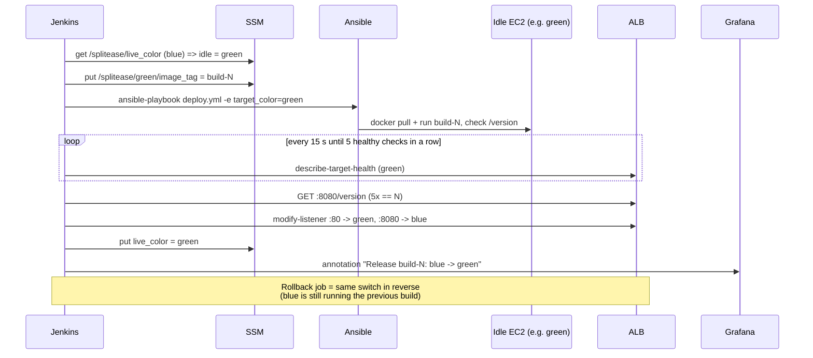
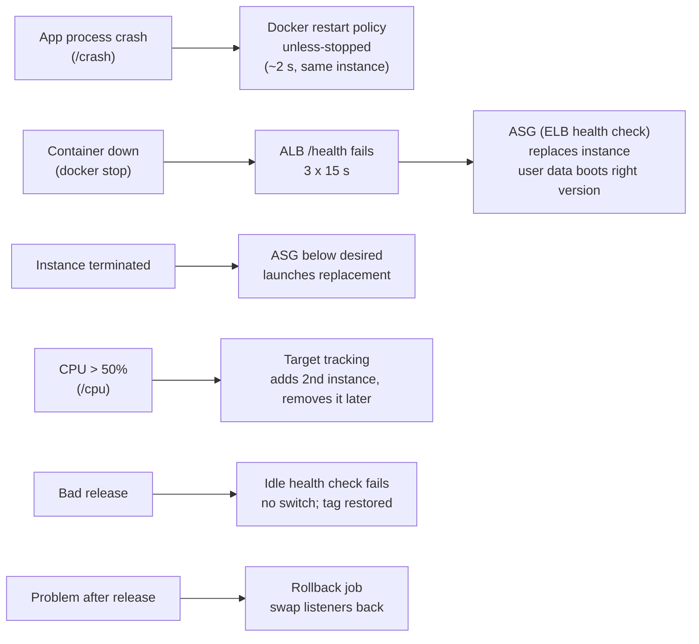
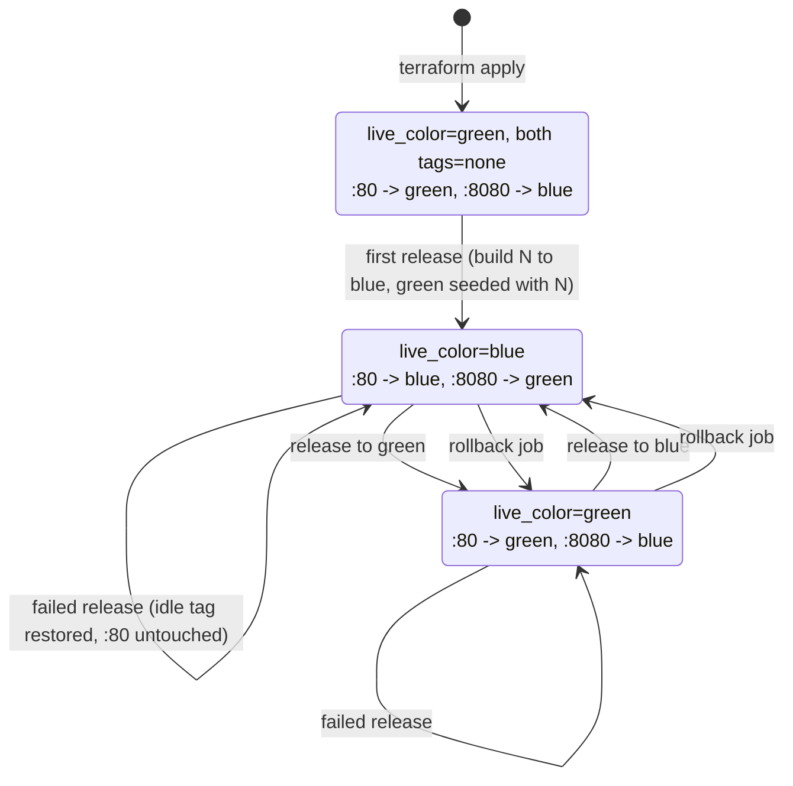

# DevSecOps Shield: architecture

Everything on this page is **implemented and was demonstrated on AWS** (2026-11-10), unless it's in
the "Future work" section. GitHub renders the diagrams; for the report, screenshot them or paste the
code into https://mermaid.live.

## 1. System overview

**Who does what**

| Component | Role in this project |
|---|---|
| GitHub | Source of truth. `main` + feature/demo branches |
| Jenkins (local, Docker) | Multibranch pipeline. CI on every branch; release (ECR + Blue-Green) on `main` only |
| pytest / Gitleaks / Trivy | Quality gate / Security Gate 1 (secrets) / Security Gate 2 (image CVEs) |
| ECR | Stores only images that passed every gate (`build-<N>`, immutable) |
| Terraform | Creates all 47 AWS resources (VPC, SGs, ALB, ASGs, IAM, SSM, CloudWatch, SNS, ECR); see §8 |
| SSM Parameter Store | Which colour is live, which image each colour runs, chaos flag |
| Ansible | Updates the *running* instances of the idle colour (`deploy.yml`, dynamic inventory) |
| EC2 user data | Boots *new* instances (scaling/replacement) into the version recorded in SSM |
| ALB + target groups | Health checks (`/health`) and instant Blue-Green switching |
| Auto Scaling Groups | Replace unhealthy/terminated instances; scale out on CPU > 50% |
| CloudWatch + SNS | Logs, metrics, alarms, email |
| Grafana (local, Docker) | Dashboard over CloudWatch; Jenkins annotates each switch/rollback |

## 2. Pipeline (Jenkinsfile)

## 3. Blue-Green release and rollback

## 4. Self-healing layers

## 5. Network and security boundaries

| From → To | Allowed | Enforced by |
|---|---|---|
| Internet → ALB :80 | yes | ALB security group |
| Internet → ALB :8080 (idle colour) | **student IP only** | ALB SG (`var.my_ip`) |
| ALB → EC2 :5000 | yes | App SG references ALB SG |
| Internet → EC2 :5000 | **no** | App SG (only from ALB SG) |
| Laptop (Jenkins/Ansible) → EC2 :22 | **student IP only** | App SG |
| EC2 → internet | HTTPS (443) only | App SG egress |
| Container → instance metadata (credentials) | **no** | IMDSv2 required, hop limit 1 |

Identities (least privilege): EC2 instance role (pull own repo, read `/splitease/*`, write own log
group) · Jenkins IAM user (push own repo, `/splitease/*` params, switch *our two* listeners) ·
Grafana IAM user (read-only) · student's Terraform user (`SplitEaseTerraformRunner`: EC2/ELB/ASG in
ap-south-1, everything else only `splitease-*`). No access keys exist in the repo or Terraform state.

## 6. Blue-Green state (SSM + listeners)

## 7. Data flows

| Flow | Path | Notes |
|---|---|---|
| Code | developer → GitHub → Jenkins (polls every minute) | multibranch: each branch has its own job |
| Image | Jenkins `docker build` → Trivy → ECR (`build-N`) → EC2 `docker pull` | only after all gates; immutable tag |
| Desired version | Jenkins → SSM `/splitease/<colour>/image_tag` → Ansible (running instances) and user data (new instances) | single source of truth |
| Traffic | users → ALB :80 → live target group → container :5000 | :8080 → idle target group (your IP only) |
| Health | ALB → `GET /health` every 15 s → target state → ASG (ELB health check) | 2 OK = healthy, 3 failures = unhealthy |
| Logs | container stdout → Docker `awslogs` driver → CloudWatch Logs `/splitease/app` → Grafana Logs Insights | stream `<colour>/<instance-id>` |
| Metrics | EC2 (1-min detailed monitoring), ASG group metrics, ALB/target-group metrics → CloudWatch → alarms and Grafana | |
| Alerts | CloudWatch alarm → SNS `splitease-alerts` → email | ALARM and OK notifications |
| Annotations | Jenkins (after a switch / rollback) → `scripts/grafana-annotate.sh` → Grafana API `http://grafana:3000/api/annotations` | tag `splitease` + `release`/`rollback` + colour; never fails the build |

## 8. AWS resource inventory (Terraform, 47 resources)

| File | Resources |
|---|---|
| `network.tf` | `aws_vpc.main`, `aws_internet_gateway.main`, `aws_subnet.public` ×2, `aws_route_table.public`, `aws_route_table_association.public` ×2 |
| `security_groups.tf` | `aws_security_group.alb`, `aws_security_group.app`, ingress rules `alb_http`, `alb_test`, `app_from_alb`, `app_ssh`, egress rules `alb_to_app`, `app_https_out` |
| `ecr.tf` | `aws_ecr_repository.app`, `aws_ecr_lifecycle_policy.app` |
| `iam.tf` | `aws_iam_role.ec2`, `aws_iam_role_policy.ec2`, `aws_iam_instance_profile.ec2`, `aws_iam_user.jenkins`, `aws_iam_user_policy.jenkins`, `aws_iam_user.grafana`, `aws_iam_user_policy.grafana` |
| `alb.tf` | `aws_lb.app`, `aws_lb_target_group.app` ×2 (blue, green), `aws_lb_listener.prod` (80), `aws_lb_listener.test` (8080) |
| `launch_templates.tf` | `aws_key_pair.deploy`, `aws_launch_template.app` ×2 |
| `autoscaling.tf` | `aws_autoscaling_group.app` ×2, `aws_autoscaling_policy.cpu` ×2 |
| `ssm.tf` | `aws_ssm_parameter.live_color`, `aws_ssm_parameter.image_tag` ×2, `aws_ssm_parameter.chaos_mode` |
| `cloudwatch.tf` | `aws_cloudwatch_log_group.app`, `aws_sns_topic.alerts`, `aws_sns_topic_subscription.email`, `aws_cloudwatch_metric_alarm.high_cpu` ×2, `aws_cloudwatch_metric_alarm.unhealthy_hosts` ×2 |

Data sources (read only): availability zones, caller identity, latest AL2023 AMI (public SSM
parameter), IAM policy documents. EC2 instances are **not** Terraform resources: the Auto Scaling
Groups create and replace them.

## 9. Configuration reference (every value)

| Component | Setting | Value | Why |
|---|---|---|---|
| VPC | CIDR / subnets | `10.20.0.0/16`; `10.20.0.0/24` (ap-south-1a), `10.20.1.0/24` (ap-south-1b) | ALB needs 2 AZs |
| Subnets | public IP on launch | yes | reach ECR/SSM/CloudWatch without NAT |
| ALB | listeners | 80 (production), 8080 (test) | `ignore_changes = [default_action]` |
| ALB | `drop_invalid_header_fields` | true | request-smuggling defence |
| Target groups | port / path / matcher | 5000 / `/health` / 200 | |
| Target groups | interval / timeout / healthy / unhealthy | 15 s / 5 s / 2 / 3 | unhealthy after ~45 s |
| Target groups | deregistration delay | 30 s | faster switches/replacements (default 300 s) |
| Launch template | AMI / type | latest Amazon Linux 2023 / t3.micro | free-plan type |
| Launch template | CPU credits | `standard` | no surprise bills (no launch credits) |
| Launch template | monitoring | detailed (1-minute) | scaling/alarms react in minutes |
| Launch template | metadata | IMDSv2 required, hop limit 1 | containers can't read instance credentials |
| Launch template | root volume | gp3, encrypted, delete on termination | |
| Launch template | tags | `Name`, `Project=splitease`, `Env=<colour>` | Ansible inventory groups |
| ASG | min / desired / max | 1 / 1 / 2 | cost cap |
| ASG | health check | ELB, grace 600 s, warm-up 600 s | measured boot ~440 s at 0 credits |
| ASG | `wait_for_capacity_timeout` | 0 | instances can't be healthy before the first release |
| ASG | scaling policy | target tracking, `ASGAverageCPUUtilization` = 50% | |
| ASG | group metrics | desired, in service, total (1-minute, free) | Grafana instance panel |
| Alarms | high CPU | `CPUUtilization` avg > 70%, 60 s × 3, per ASG | email |
| Alarms | unhealthy hosts | `UnHealthyHostCount` max > 0, 60 s × 2, per target group | email; missing data = OK |
| Logs | group / retention | `/splitease/app` / 7 days | |
| ECR | tags / encryption / lifecycle | immutable / AES256 / keep 5 | |
| Container | image / user / port | `python:3.14.10-slim-trixie`, uid 10001, 5000 | |
| Container | run flags | `--restart unless-stopped`, `--log-driver awslogs`, `-e CHAOS_MODE` | |
| Gunicorn | workers / timeout | 2 / 30 s (default) | `/cpu` returns immediately for this reason |
| Pipeline | health gate | 5 consecutive healthy polls, 15 s apart, timeout 900 s; fail after 4 polls of `ResponseCodeMismatch` | ALB shows the old container's state for up to 45 s |
| Pipeline | version gate | `/version` == build N, 5 in a row, up to 40 tries 3 s apart | |
| Rollback | health check | 2 consecutive healthy polls, timeout 120 s | nothing was just deployed there |
| Jenkins | executors / trigger | 1 / branch indexing every 60 s | one release at a time; no duplicate builds |
| Grafana | version / bind / refresh | 13.2.5 / 127.0.0.1:3000 / 1 min | |

## 10. IAM permission matrix

| Identity | Actions | Resources |
|---|---|---|
| **EC2 role** `splitease-ec2-role` | `ecr:GetAuthorizationToken` | `*` (no resource-level support) |
| | `ecr:BatchCheckLayerAvailability`, `BatchGetImage`, `GetDownloadUrlForLayer` | repo `splitease` |
| | `ssm:GetParameter` | `parameter/splitease/*` |
| | `logs:CreateLogStream`, `PutLogEvents` | log group `/splitease/app` |
| **Jenkins user** `splitease-jenkins` | `ecr:GetAuthorizationToken` | `*` |
| | ECR push (`InitiateLayerUpload`, `UploadLayerPart`, `CompleteLayerUpload`, `PutImage`, ...) | repo `splitease` |
| | `ssm:GetParameter`, `ssm:PutParameter` | `parameter/splitease/*` |
| | `elasticloadbalancing:Describe*` | `*` |
| | `elasticloadbalancing:ModifyListener` | **only the 2 SplitEase listeners** |
| | `ec2:DescribeInstances`, `autoscaling:Describe*` | `*` |
| **Grafana user** `splitease-grafana` | `cloudwatch:GetMetricData`, `ListMetrics`, `DescribeAlarms*`, `DescribeAlarmHistory` | `*` |
| | `logs:DescribeLogGroups`, `GetQueryResults`, `StopQuery` | `*` |
| | `logs:StartQuery`, `GetLogGroupFields`, `GetLogEvents`, `FilterLogEvents` | log group `/splitease/app` |
| | `ec2:DescribeRegions`, `DescribeInstances`, `DescribeTags`, `tag:GetResources` | `*` |
| **Terraform runner** (student's user, policy `SplitEaseTerraformRunner`) | `ec2:*`, `elasticloadbalancing:*`, `autoscaling:*` | `*` **in ap-south-1 only** |
| | `ecr:*` / `ssm:*` / `logs:*` / `sns:*` / alarm writes | `splitease` repo / `/splitease/*` / `/splitease/*` logs / `splitease-*` topics / `splitease-*` alarms |
| | `iam:*` | roles, users, instance profiles named `splitease-*` |
| | `iam:CreateServiceLinkedRole` | only for ELB and Auto Scaling |

No identity can change its own permissions. Access keys exist only for the two IAM users, are
created by hand, and live only in Jenkins Credentials / `jenkins/.env`.

## 11. Jenkins configuration

| Item | Value |
|---|---|
| Image | `splitease-jenkins:2.580.2` = `jenkins/jenkins:2.580.2-lts-jdk21` + Docker CLI 29.9.3, buildx 0.38.2, Gitleaks 8.30.1, Trivy 0.76.1, AWS CLI 2.39.7, Python 3.13, Ansible core 2.21.6, `amazon.aws` 11.5.1, boto3 1.43.127, jq, OpenSSH (all SHA-256 verified) |
| Run | docker compose, `127.0.0.1:8080`, volume `jenkins_home`, Docker socket mounted, `group_add` 1001 (non-root) |
| Jobs (as code, `jenkins/jobs/`) | `splitease` (multibranch, Jenkinsfile) · `splitease-rollback` (pipeline, `Jenkinsfile.rollback` from `main`) |
| Credentials | `aws-access-key-id`, `aws-secret-access-key`, `ec2-ssh-key`, `grafana-api-token` |
| Executors | 1 (`init.groovy.d/executors.groovy`) |

## 12. Grafana dashboard map ("SplitEase - Production", uid `splitease-production`)

| Panel | Namespace / metric | Dimensions | Statistic | Query type |
|---|---|---|---|---|
| CPU utilisation per ASG | `AWS/EC2 CPUUtilization` | `AutoScalingGroupName` = splitease-blue / -green | Average | builder |
| Instances per ASG | `AWS/AutoScaling GroupInServiceInstances`, `GroupDesiredCapacity` | `AutoScalingGroupName` | Maximum | builder |
| Healthy hosts per colour | `AWS/ApplicationELB HealthyHostCount` | LoadBalancer, TargetGroup (SEARCH "splitease") | Maximum | SEARCH expression |
| Unhealthy hosts per colour | `UnHealthyHostCount` | same | Maximum | SEARCH |
| ALB requests by colour | `RequestCount` per target group + total per ALB | same | Sum | SEARCH |
| Response time | `TargetResponseTime` | LoadBalancer | Average, p95 | SEARCH |
| 5xx errors | `HTTPCode_ELB_5XX_Count`, `HTTPCode_Target_5XX_Count` | LoadBalancer | Sum | SEARCH |
| App logs | Logs Insights on `/splitease/app` | | `fields @timestamp, @logStream, @message \| sort @timestamp desc \| limit 200` | logs |
| Annotations | Grafana annotations with tag `splitease` | | | built-in |

Data source `CloudWatch` (uid `cloudwatch`, auth = access key from env vars, region ap-south-1),
provisioned from `grafana/provisioning/`. The dashboard is read-only in the UI and is changed only
through `grafana/dashboards/splitease-production.json`.

## 13. Timings (measured 2026-11-10/11)

| Event | Time |
|---|---|
| Normal release, push → traffic switched | ~3 min (builds #10, #12, #13, #14: 186–194 s) |
| CI only (feature/demo branch) | ~1.5–4 min |
| Zero-credit t3.micro: Docker install in user data | 311 s (72% CPU steal) |
| New instance healthy after launch | ~5–8 min |
| Bad release detected | ~90 s after deploy |
| `/crash` outage | ~2 s (one 502) |
| `docker stop` → instance replaced | 1 min 47 s |
| `/cpu` → scale-out | ~4 min; scale-in ~16 min after the load ended |
| Rollback job | 154 s |

## 14. Future work (not implemented)

HTTPS with ACM certificate · WAF · private subnets + NAT/VPC endpoints · Secrets Manager · remote
Terraform state (S3 + DynamoDB lock) · IAM permissions boundary for the Terraform runner · drift
detection · SonarQube/Semgrep/OWASP dependency scanning · canary releases · Kubernetes/ECS ·
multi-region. Prometheus was deliberately not used: Grafana reads CloudWatch directly.
