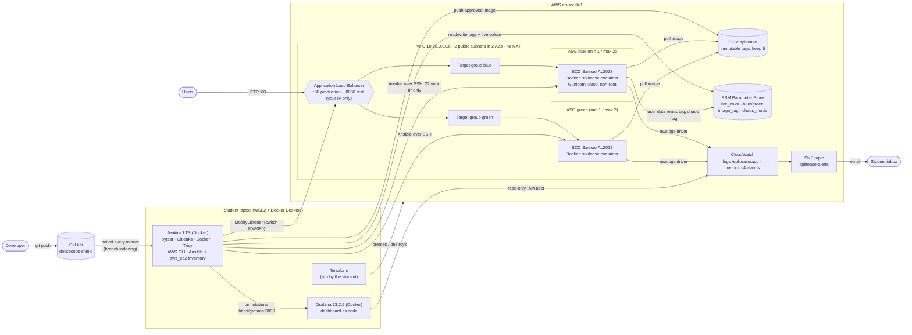
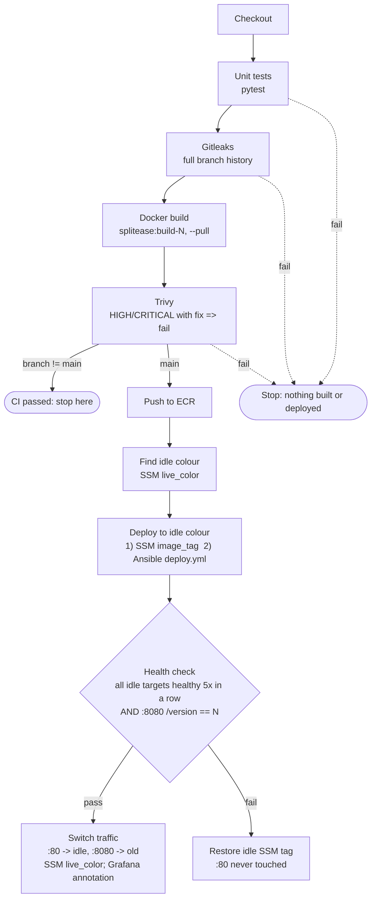
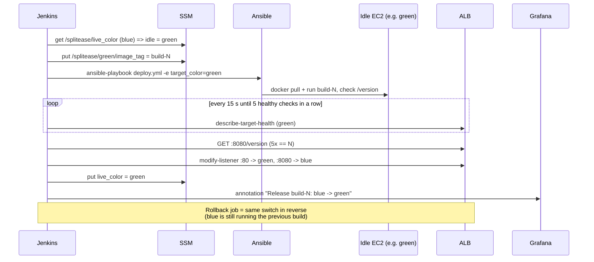
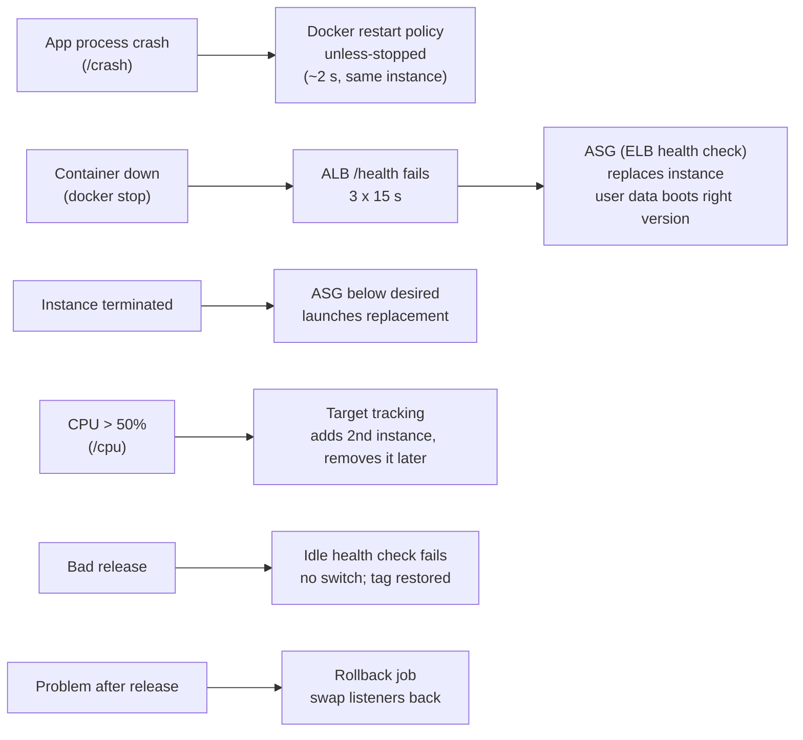

# DevSecOps Shield: architecture

Everything on this page is **implemented and was demonstrated on AWS** (2026-11-10), unless it's in
the "Future work" section. GitHub renders the diagrams; for the report, screenshot them or paste the
code into https://mermaid.live.

## 1. System overview

**Who does what**

| Component | Role in this project |
|---|---|
| GitHub | Source of truth. `main` + feature/demo branches |
| Jenkins (local, Docker) | Multibranch pipeline. CI on every branch; release (ECR + Blue-Green) on `main` only |
| pytest / Gitleaks / Trivy | Quality gate / Security Gate 1 (secrets) / Security Gate 2 (image CVEs) |
| ECR | Stores only images that passed every gate (`build-<N>`, immutable) |
| Terraform | Creates all 47 AWS resources (VPC, SGs, ALB, ASGs, IAM, SSM, CloudWatch, SNS, ECR) |
| SSM Parameter Store | Which colour is live, which image each colour runs, chaos flag |
| Ansible | Updates the *running* instances of the idle colour (`deploy.yml`, dynamic inventory) |
| EC2 user data | Boots *new* instances (scaling/replacement) into the version recorded in SSM |
| ALB + target groups | Health checks (`/health`) and instant Blue-Green switching |
| Auto Scaling Groups | Replace unhealthy/terminated instances; scale out on CPU > 50% |
| CloudWatch + SNS | Logs, metrics, alarms, email |
| Grafana (local, Docker) | Dashboard over CloudWatch; Jenkins annotates each switch/rollback |

## 2. Pipeline (Jenkinsfile)

## 3. Blue-Green release and rollback

## 4. Self-healing layers

## 5. Network and security boundaries

| From → To | Allowed | Enforced by |
|---|---|---|
| Internet → ALB :80 | yes | ALB security group |
| Internet → ALB :8080 (idle colour) | **student IP only** | ALB SG (`var.my_ip`) |
| ALB → EC2 :5000 | yes | App SG references ALB SG |
| Internet → EC2 :5000 | **no** | App SG (only from ALB SG) |
| Laptop (Jenkins/Ansible) → EC2 :22 | **student IP only** | App SG |
| EC2 → internet | HTTPS (443) only | App SG egress |
| Container → instance metadata (credentials) | **no** | IMDSv2 required, hop limit 1 |

Identities (least privilege): EC2 instance role (pull own repo, read `/splitease/*`, write own log
group) · Jenkins IAM user (push own repo, `/splitease/*` params, switch *our two* listeners) ·
Grafana IAM user (read-only) · student's Terraform user (`SplitEaseTerraformRunner`: EC2/ELB/ASG in
ap-south-1, everything else only `splitease-*`). No access keys exist in the repo or Terraform state.

## 6. Future work (not implemented)

HTTPS with ACM certificate · WAF · private subnets + NAT/VPC endpoints · Secrets Manager · remote
Terraform state (S3 + DynamoDB lock) · IAM permissions boundary for the Terraform runner · drift
detection · SonarQube/Semgrep/OWASP dependency scanning · canary releases · Kubernetes/ECS ·
multi-region. Prometheus was deliberately not used: Grafana reads CloudWatch directly.
